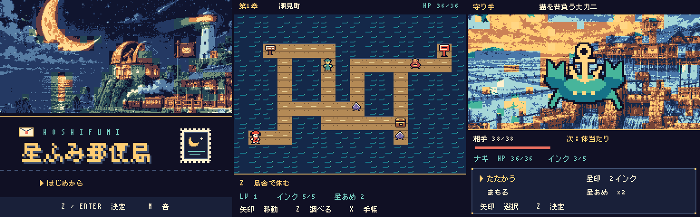

# Hoshifumi ｜ 星ふみ郵便局

> 「帰り船にともす灯は、何色だった？」

十年前の嵐で父が消えた。今朝、ナギの机には、潮にぬれた封筒が一通。見習い配達員が七つの町で手紙を届け、家族の時間を動かす、日本語の短編コマンドRPGです。



## Windows で遊ぶ

Windows x64 用の配布フォルダーを展開し、**Hoshifumi.exe** を起動します。自己完結版には .NET が同梱されています。ゲームはキーボードまたはXInput互換コントローラーで操作できます。

| 操作 | キーボード | コントローラー |
|---|---|---|
| 移動・選択 | 矢印 / WASD | 十字キー |
| 決定・調べる・話す | Z / Enter / Space | A |
| 手帳・もどる | X / Esc | B / Start |
| 消音切替 | M | — |
| 全画面切替 | F11 | — |

**最初の配達**　帽子をかぶったナギを動かし、立札を読んで案内人に話しかけます。物の上か、すぐ隣でその方向を向いて Z を押してください。宛先が判明したら守り手にぶつかって戦い、赤いポストに投函します。道中の箱には星あめが、屋根のある局舎には休憩場所があります。

**戦闘**　画面中央の「次」で相手の予告を確認します。「まもる」は被害を減らしてインクを2回復。「星印」はインク2で敵の硬い構えを貫きます。体力が減ったら星あめを。敗北時は局舎から再出発します。

**記録**　宛先の判明、補給箱、戦闘勝利、章の移行、手帳を開いたときなどに自動保存します。Windows の保存先は `%LOCALAPPDATA%\Hoshifumi\save.json`。記録は1枠で、最終章には追伸の宛先で変わる二つの結末があります。

## 七通の配達

| 章 | 行き先 | 手紙に残ったもの |
|---|---|---|
| 一　潮待ちの水門 | 潮見町 | 白い貝がら |
| 二　返事の鳴る森 | 鈴木立 | 鳴らない鈴 |
| 三　砂時計の終着駅 | 砂の終着駅 | 動く時刻の切符 |
| 四　凍らない病室 | 氷窓の街 | 折り紙の舟 |
| 五　空庭の種屋 | 空庭群島 | 切手を貼った種 |
| 六　赤熱の活版所 | 火床の町 | 文字のない紙 |
| 七　明日の消印 | 星海中央局 | 「明日のナギへ」の封筒 |

## 開発・ビルド

.NET 8 SDK と MonoGame DesktopGL 3.8.4.1 を使用します。リポジトリのルートで実行してください。画像はPNG、楽曲は譜面からの合成で、コンテンツの事前変換は不要です。

```powershell
dotnet run -c Release
dotnet run -c Release -- --verify
dotnet publish -c Release -r win-x64 --self-contained true -o out/win-x64
```

`--verify` は画面を開かず、マップ・戦闘・再挑戦・セーブ・両方のエンディングと、全曲のPCM生成を確認します。

## グラフィックと音楽

画面は256×240。日本語の字形は8ドット、マップは16ドット単位で構成しています。タイトルと七地方の背景は本作用の生成原画から限られた色のピクセル画像に変換しました。主人公・敵・地形・オブジェクトは座標とパターンで作画しています。家庭用PC向けのファミコン風表現です。

- `Assets/chapters.json` に各章の物語、マップ、宛先の問いを収録。
- `Assets/Graphics` に背景8枚と、主人公、道中の敵7種、守り手7種、タイル、日本語字形を収録。
- `Assets/Music/score.json` にタイトル、七つのフィールド曲、通常戦、守り手戦、エンディングの全11曲を収録。`Game/Audio.cs` が矩形波2声、三角波ベース、ノイズ打楽器で演奏します。
- `Tools/artwork.py` と `Tools/font.py` はグラフィックの制作ツールです。実行にはPython、Pillow、NumPyを使います。完成素材はすべて同梱しています。
- フォントなどのクレジットは [THIRD-PARTY.txt](THIRD-PARTY.txt) に記載しています。

全11曲を通常のWAVファイルに書き出せます。

```powershell
dotnet run -c Release -- --export-music out/ost
```
